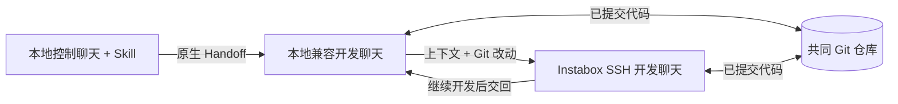

# Codex × Instabox Handoff

在 Codex 中连接 Instabox 云电脑，让一个项目完成 **本地开始 → 云端继续 → 回到本地**。

这个仓库包含完整配置指南、可安装的 `instabox-handoff` Skill、兼容聊天创建脚本、Git 同步工具和隔离测试。使用已有 Instabox 机器即可，不需要部署额外服务。

> **兼容性边界**：在本项目实测版本中，默认 `paginated` 聊天不能跨主机 Handoff；需要通过 App Server 创建 `legacy` 兼容聊天。切换指令从另一个本地控制聊天发起。原生迁移由 Codex 桌面应用完成，Python 脚本本身不是聊天迁移服务。

## 工作方式



- **SSH 连接**：桌面应用通过已有 SSH alias 启动远端 Codex App Server。
- **代码同步**：Git 推送与快进拉取，用于共享已提交代码；支持已有 Git 服务，也支持 Instabox 持久磁盘上的 bare repo。
- **聊天交接**：Codex 原生 Handoff 迁移上下文及工作改动。每次迁移后记录新的聊天 ID 和实际 worktree 路径。

## 安装 Skill

支持 macOS / Linux，Python 3.9+。桌面端必须提供 SSH Connections 及原生 Handoff 工具；CLI 单独安装不代表拥有桌面交接功能。

```sh
git clone https://github.com/jingchang0623-crypto/codex-instabox-handoff.git
cd codex-instabox-handoff
python3 scripts/install_skill.py
```

默认安装到 `${CODEX_HOME:-$HOME/.codex}/skills/instabox-handoff`。已存在时不会覆盖；升级使用 `--upgrade`，安装器先备份旧目录。安装器只复制 Skill，不登录账户、创建云电脑、修改 SSH 配置或覆盖 profile。

接着阅读 [从零配置 Instabox 与 Codex SSH](skills/instabox-handoff/references/setup.md)，准备机器、SSH、远端 Codex 和两个已保存的 Git 项目。

## 一句话使用

在本地控制聊天中发送：

```text
$instabox-handoff 为当前项目创建可 Handoff 的兼容开发聊天。
$instabox-handoff 将项目 my-project 的已提交代码同步到云端。
$instabox-handoff 把 my-project 开发聊天切到 Instabox，运行项目并继续开发。
$instabox-handoff 把 my-project 开发聊天切回本地，检查云端最新改动。
```

也可以一次要求“创建兼容聊天，先本地运行，再到云端验证，最后切回本地”。Skill 会等待每一阶段完成，再继续下一次交接。

新项目首次加入 Codex 的已保存项目列表可能需要一次界面操作。后续步骤可由控制聊天协调。若当前聊天还没发现新安装的 Skill，新建本地控制聊天后再调用。

## 文档与入口

| 内容 | 入口 |
| --- | --- |
| 登录、云电脑、SSH、远端 Codex、Git 配对、证书续期 | [配置指南](skills/instabox-handoff/references/setup.md) |
| Skill 工作流和权限边界 | [SKILL.md](skills/instabox-handoff/SKILL.md) |
| 本地→云端→本地的完整验证步骤 | [接力示例](docs/handoff-walkthrough.md) |
| origin 缓存、分页聊天、草稿、分支占用等故障 | [操作与排障](skills/instabox-handoff/references/workflow.md) |
| 实测版本、证据范围和测试方法 | [验证说明](docs/validation.md) |
| 个人项目与聊天索引格式 | [profile 示例](examples/profile.example.json) |

## 脚本

```sh
python3 skills/instabox-handoff/scripts/handoff.py --help
python3 skills/instabox-handoff/scripts/handoff.py profile
python3 skills/instabox-handoff/scripts/handoff.py doctor --wake
python3 skills/instabox-handoff/scripts/handoff.py sync --project my-project --direction to-cloud
```

`sync` 默认预览，加 `--apply` 执行。遇到脏工作树、分支不一致、目标分歧或非快进关系时保留现场，不自动提交、强推、重置或覆盖。源推送成功但目标无法快进时，会明确报告同步未完成。

## 测试

```sh
python3 -m unittest discover -s tests -v
```

测试使用临时 Git 仓库、模拟 SSH/stdio 服务和临时 SSH 测试证书，不连接你的真实账户或云电脑。GitHub Actions 运行同一测试集。真实主机 Handoff 需要桌面端工具，不能由这些隔离测试代替。

## 限制与数据

- `historyMode=legacy` 属于当前安装版本的 App Server 协议能力；升级后应重验，不承诺普通聊天自动无损转换。
- Codex 工具不能交接正在发起调用的聊天自身，因此保留本地控制聊天，迁移另一个开发聊天。
- 依赖、运行进程和凭证需在目标机器单独配置。Handoff 不等于整台电脑迁移，Git 同步也不是实时文件镜像。
- profile 和聊天索引保存在本机 `~/.config/codex-instabox-handoff/`，不应提交到公开仓库。不要发布私钥、登录态、`.env` 或带 token 的 Git URL。
- 本项目不是 OpenAI 或 Instabox 官方产品。SSH 和 App Server 能力参考 [OpenAI 官方远程连接文档](https://learn.chatgpt.com/docs/remote-connections) 与 [Codex App Server 文档](https://developers.openai.com/codex/app-server)；兼容格式和缓存故障结论来自指定版本实测。

## 致谢与许可

流程探索受 [v01dstar/herdr-instabox](https://github.com/v01dstar/herdr-instabox) 启发。这里提供面向 Codex 的独立文档、Skill 和 Python 实现，没有复制该项目源码；该上游的许可不由本仓库授予。

本仓库原创代码和文档采用 [MIT License](LICENSE)。Instabox CLI 见 [npm 包](https://www.npmjs.com/package/instabox) 与 [Instabox 官网](https://instabox.sh)。
