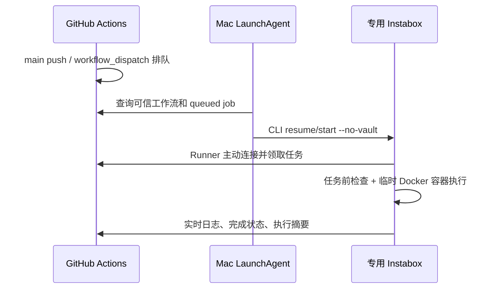

# GitHub Actions + Instabox 自托管 CI

GitHub 负责触发、排队、日志与检查结果；专用 Instabox 负责执行。Mac 上的轻量后台代理每 30 秒检查队列，需要时调用官方 CLI 唤醒指定机器。**唤醒不经过 GitHub 托管 runner，因此不消耗托管运行分钟额度。**

本方案按用户选择使用 Mac 后台代理；Mac 必须在线、未休眠且用户的 LaunchAgent 可运行。关闭 Codex 窗口不会停止该代理。Mac 休眠或离线时，新任务可能排队，恢复后继续检查。已经被云端 runner 领取的任务可独立执行并向 GitHub 回传。它不是独立于 Mac 的云端 webhook 服务。



## 边界

- 使用专用机器，与 Codex 开发机分开。复用已有空闲机器，不覆盖已有项目或删除机器。
- 只支持指定仓库 main 分支的 push / workflow_dispatch。这里的自托管工作流不触发公开 fork PR；PR 检查应使用独立的 GitHub 托管 runner 或另行设计受控的临时执行环境。
- Mac 的 gh / Instabox 登录态保留在本机。云端仅保存 GitHub runner 自身的仓库级注册状态，不复制 Mac 的 gh token、Instabox token、SSH 私钥或 Codex auth.json。
- Runner 使用独立 Linux 用户；服务无法直接访问模板用户的 `/data/home`。每个测试 job 运行在临时 Docker 容器中，未挂载开发目录或 Docker socket。
- 预任务 hook 在 checkout 前检查仓库、ref 与事件，不满足条件直接失败。Hook 由 root 管理并放在 runner 应用目录外。
- Docker 组具有较高主机权限；这些设置并不把持久自托管 runner 变成可安全执行任意敌对代码的平台。仅运行可信主分支任务。

## 1. 准备工具和机器

Mac 需要 Python 3.9+、已登录的 `gh` 与 Instabox CLI：

```sh
gh auth status
instabox whoami
instabox ls --json
```

选择已有专用机器，例如 `ci-box`。它需要 x86_64 Linux、systemd、Docker、curl、Python 3，以及可用的免交互 sudo。不要选正在运行 Codex 开发聊天的机器。

首次恢复时禁用 Vault 自动投递：

```sh
instabox resume ci-box --no-vault
```

不要在这台机器放置其他开发凭证。若它曾承载敏感业务，不把该机器直接改作公开仓库的 runner。

## 2. 配置 runner

在本仓库目录执行：

```sh
python3 ci/provision_runner.py \
  --repository YOUR_ACCOUNT/YOUR_REPO \
  --machine ci-box \
  --name instabox-ci-linux \
  --label instabox-ci \
  --instabox /ABSOLUTE/PATH/instabox
```

脚本通过 gh 获取官方 runner 最新 Linux x64 发布及 SHA256，校验下载包，然后用一小时有效的注册 token 完成配置。token 只在进程内存和远端安装输入中使用，不写入本仓库或 Mac 配置。

远端安装：

- runner 用户和数据：`/data/ci-runner/actions-runner`
- root 管理的任务前检查：`/opt/codex-instabox-ci/job_guard.*`
- 开机自启服务：`codex-instabox-runner.service`
- 自定义 label：`instabox-ci`，不启用通用的默认 runner labels

已存在的 `.runner` 必须属于同一仓库、同一 runner 名称，脚本才复用；不会擅自替换其他仓库的注册配置。自动发现的平台版本应在更新后重新验证。

公开仓库还应在 Actions 设置中要求外部贡献者的工作流获得批准。当前部署仓库已将审批策略设为所有外部贡献者；这不替代任务前 hook 和可信任务范围。

## 3. 安装 Mac 自动唤醒代理

```sh
python3 ci/install_macos.py \
  --repository YOUR_ACCOUNT/YOUR_REPO \
  --machine ci-box \
  --gh /ABSOLUTE/PATH/gh \
  --instabox /ABSOLUTE/PATH/instabox
```

先预览可加 `--dry-run`，默认每 30 秒检查一次。安装位置：

```text
~/Library/LaunchAgents/dev.codex.instabox-ci-waker.plist
~/Library/Application Support/CodexInstaboxCI/
  config.json
  waker.py
  state.json
  waker.log
  waker.stderr.log
```

配置只存仓库、机器名称、CLI 路径和策略，不存凭证。代理复制到稳定安装目录，之后移走本仓库不会使代理丢失脚本。

代理同时查询 queued 和 in_progress 的 workflow run，再确认其中有 `instabox-ci` label 的 queued job。只有指定工作流、同仓库来源和可信事件/ref 才会触发恢复。机器暂停时 resume，停止时 start；两者均带 `--no-vault`。没有任务时不会探测远端 shell，避免不断制造活动而阻止空闲休眠。

同一代理使用文件锁避免重叠，唤醒有 120 秒冷却期。API 或登录失败会记录错误并在下个周期重试；不会创建机器、购买额度、变更套餐或尝试登录。

## 4. 工作流

本仓库 [tests.yml](../.github/workflows/tests.yml) 已使用：

```yaml
runs-on: instabox-ci
container:
  image: python:${{ matrix.python-version }}-bookworm
```

Python 3.9 / 3.12 顺序运行，每个 job 使用临时容器，并设置时间、CPU、内存和进程数上限。只读仓库权限，checkout 不保留 Git 凭证。日志和结论由标准 Actions runner 直接回传，不需自建结果回调接口；执行摘要写入 `GITHUB_STEP_SUMMARY`，本方案不依赖上传 artifact 或缓存。

自托管不消耗 GitHub 托管分钟，制品/缓存存储仍有单独计量，Instabox 的机器资源也受自身套餐和服务限制。参见 [GitHub 计费说明](https://docs.github.com/en/billing/concepts/product-billing/github-actions)。

## 5. 真正验证唤醒与回传

先确认 runner 在 GitHub 中 online，且没有运行中的任务，再挂起专用机器：

```sh
instabox suspend ci-box
gh workflow run tests.yml --repo YOUR_ACCOUNT/YOUR_REPO --ref main
```

然后观察：

```sh
gh run list --repo YOUR_ACCOUNT/YOUR_REPO --workflow tests.yml --limit 3
cat "$HOME/Library/Application Support/CodexInstaboxCI/waker.log"
```

成功判据：起始 state=suspended → 新任务 queued → 代理记录 resumed → runner 执行 → 两个 Python job 成功，GitHub 可查看日志和执行摘要。不要只凭“机器 running”判断 CI 已成功。

验证失败回传：

```sh
gh workflow run tests.yml --repo YOUR_ACCOUNT/YOUR_REPO --ref main -f smoke_failure=true
```

该输入在测试之后故意 `exit 1`，应看到标准 failed 状态及日志。随后以默认输入再跑一次，确认恢复为绿色。失败演练不会修改业务代码，也不应被描述成测试本身的缺陷。

保留机器已有的空闲休眠策略。当前验证通过手动 suspend 模拟冷态恢复；不把“从 suspend 恢复成功”当作已等待完整空闲周期并验证自动休眠。

## 运维和停用

```sh
# 查看代理状态（LaunchAgent 在两次轮询之间显示 not running 是正常的）
launchctl print gui/$(id -u)/dev.codex.instabox-ci-waker

# 手动执行一次诊断
python3 "$HOME/Library/Application Support/CodexInstaboxCI/waker.py" \
  --config "$HOME/Library/Application Support/CodexInstaboxCI/config.json"

# 停用自动唤醒；不删除 runner、不删除机器
launchctl bootout gui/$(id -u)/dev.codex.instabox-ci-waker
```

runner 由 systemd 管理，远端可用 `sudo systemctl status codex-instabox-runner` 或 `journalctl -u codex-instabox-runner` 检查。若不再使用，应先卸载本机代理，再停用远端服务，并通过 GitHub 的 runner 管理界面移除注册。`bootout` 停止当前登录会话中的代理；要防止下次登录自动恢复，另将对应 plist 移出 `~/Library/LaunchAgents/`。停用代理后，它不会再把手动暂停的 CI 机器唤醒。

如果任务一直 queued，依次检查 Mac 是否在线、代理退出码、两端登录态、label、仓库/ref/工作流策略和远端服务。若临时容器已成功启动但测试失败，直接查看 GitHub job 日志，不反复重新注册 runner。

## 官方依据

- [GitHub self-hosted runners](https://docs.github.com/en/actions/concepts/runners/self-hosted-runners)
- [任务前/后 hook](https://docs.github.com/en/actions/how-tos/manage-runners/self-hosted-runners/run-scripts)
- [自托管 runner 安全边界](https://docs.github.com/en/actions/reference/security/secure-use#hardening-for-self-hosted-runners)
- [Instabox 生命周期 API](https://instabox.sh/docs/api/lifecycle)

本仓库的具体端到端运行记录补充在 [验证说明](validation.md)。
